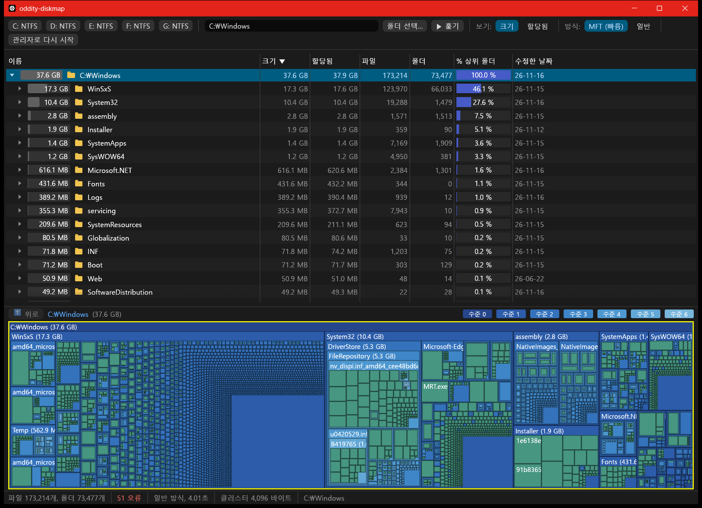

# oddity-diskmap

폴더별로 디스크를 얼마나 쓰는지 보여 주는 Windows 프로그램이다. Rust와 egui로 만들었다.



- 폴더 트리 표: 크기, 할당됨, 파일 수, 폴더 수, 상위 폴더 대비 %, 수정한 날짜
- 트리맵: 폴더와 파일을 크기에 비례한 사각형으로 그린다. 드라이브 전체를 보면 남은 공간도 함께 그린다.
- 훑는 방식 두 가지
  - MFT 방식: NTFS의 Master File Table을 볼륨에서 직접 읽는다. 폴더를 하나씩 열지 않아서 빠르다. 관리자 권한이 있어야 한다.
  - 일반 방식: 폴더를 하나씩 열어 목록을 받는다. 권한이 없거나 NTFS가 아닐 때 쓴다. 여러 스레드로 동시에 훑는다.
- MFT 방식이 실패하면 저절로 일반 방식으로 다시 훑는다.

## 측정

C: 드라이브, 파일 250만 개, 폴더 36만 개, 사용량 1.4 TB 기준.

| 방식 | 걸린 시간 | 파일 수 | 폴더 수 | 열지 못한 폴더 |
|---|---|---|---|---|
| 일반 방식 | 24.4 → 27.2초 | 2,502,198 | 357,117 | 160 |
| MFT 방식 | 2.6 → 3.7초 | 2,295,009 | 370,220 | 0 |

MFT 방식이 7 → 10배 빠르다.

두 방식의 숫자가 다른 까닭은 다음과 같다.

- 일반 방식은 권한이 없는 폴더 160개를 못 연다. `System Volume Information`(33 GB), `Program Files\WindowsApps` 같은 곳이다. MFT 방식은 이런 폴더도 센다.
- 일반 방식은 하드 링크를 이름마다 따로 세서 파일 수가 20만 개쯤 더 많다. MFT 방식은 한 번만 센다.
- `Windows` 폴더는 MFT 방식에서 크기 41.8 GB, 할당됨 36.2 GB로 나온다. 압축된 시스템 파일이 실제로 차지하는 공간을 NTFS 값 그대로 읽기 때문이다.

## 빌드

```
cargo build --release
```

결과물은 `target\release\oddity-diskmap.exe` 하나다.

## 쓰는 법

- 드라이브 단추를 누르거나 경로를 넣고 "훑기"를 누른다.
- MFT 방식을 쓰려면 "관리자로 다시 시작"을 누른다.
- 표: 행을 두 번 누르면 펼치고 접는다. 오른쪽 단추로 탐색기 열기, 경로 복사, 트리맵에서 보기를 고른다. 머리글을 누르면 정렬한다.
- 트리맵: 누르면 표에서 그 항목을 찾아 준다. 두 번 누르면 그 폴더 안으로 들어간다. 오른쪽 단추를 누르면 한 단계 위로 나온다.

명령줄로 시간만 잴 수도 있다.

```
oddity-diskmap.exe --cli C:\          # MFT 방식 (관리자 권한 필요)
oddity-diskmap.exe --cli C:\ --walk   # 일반 방식
```

## 셈하는 규칙

- 정션과 심볼릭 링크 폴더는 따라 들어가지 않는다. 같은 데이터를 두 번 세지 않기 위해서다.
- MFT 방식에서 하드 링크로 이름이 여러 개인 파일은 첫 이름 한 곳에만 센다.
- 일반 방식의 "할당됨"은 파일 크기를 클러스터 크기(보통 4,096바이트) 단위로 올려 셈한 값이다. 압축 파일은 실제보다 크게 나온다. MFT 방식은 NTFS에 적힌 값을 그대로 쓴다.

## 라이선스

MIT 라이선스다. 전문은 [LICENSE](LICENSE) 파일에 있다.
